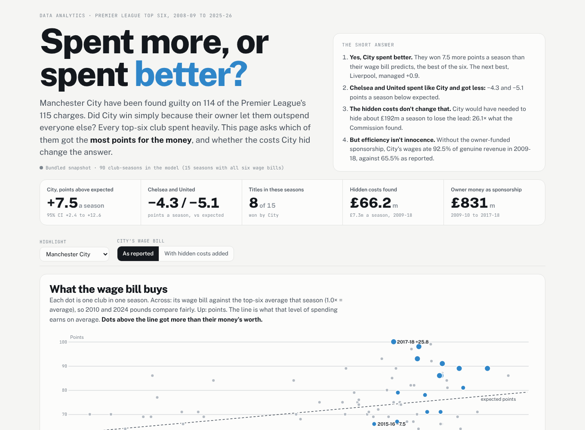

# Spent more, or spent better?

**Manchester City have been found guilty on 114 of the Premier League's 115 charges. A common reading is that City won because their owner let them outspend everyone. This project tests that: every top-six club spent heavily from 2008-09 to 2025-26, so which of them got the most points for their money? And do the costs City hid change the answer?**

Track: Data Analytics · Python, pandas, NumPy, D3.js, pytest · [Live dashboard](https://qaisbello.github.io/data-analytics/spending-efficiency/)



## What the data says

| Question | Finding |
|---|---|
| Did City outspend the others? | **Yes.** City's wage bill averaged **1.17×** the top-six average, the highest of the six. Chelsea (1.13×) and United (1.12×) were close behind. |
| Did City spend better? | **Yes.** City won **7.5 more points a season** than their wage bill predicts (95% CI +2.4 to +12.6), the best of the six. Next best: Liverpool +1.0. |
| What about the other big spenders? | Chelsea (**−4.3**) and United (**−5.1**) spent almost as much as City and got fewer points than their wages predict. |
| Is it a fluke of one season? | No. Refitting with any single season left out, City stay first every time (+6.5 to +8.7). |
| Do the hidden costs change it? | Barely. Adding the **£66.2m** the Commission found was kept off City's accounts (2009-10 to 2017-18) moves City from +7.5 to **+7.3**, still first. City would have needed to hide about **£192m a season**, 26× what was found, to drop to second. |
| Cheapest points? | Not City. Wages plus net transfer spend per point, 2009-10 to 2024-25: Spurs £2.9m, Arsenal £3.7m, Liverpool £3.9m, **City £4.4m**, Chelsea £4.9m, United £5.0m. City paid more per point and turned it into **8 titles in 15 seasons**. The last points of a title race cost the most. |
| Could City afford it? | This is where the verdict bites. **£831m** of City's 2009-18 "sponsorship" was the owner's money. Wages were **65%** of reported revenue but **93%** of revenue once that money is removed. |

**In short:** City did spend more, and they spent it better than anyone. But efficiency is not the same as compliance. The rules exist to stop clubs spending money they haven't earned, and that is what the Commission found.

## Method

- **Relative wages:** each club's wage bill divided by the top-six average that season (the wage index), so 2010 and 2024 money compare fairly.
- **Expected points:** a least-squares line of points on log(wage index), across all 90 club-seasons where all six wage bills are known (15 seasons).
- **Over-performance:** actual minus expected points. Averages come with a 95% bootstrap interval.
- **Verdict-adjusted scenario:** City's wages plus the hidden costs, spread evenly over 2009-10 to 2017-18 (the decision does not publish the timing of every item), then the model is refitted.
- **Break-even:** the extra hidden spending per season that would erase City's lead, found by bisection.
- **Affordability:** wages as a share of revenue, with the owner-funded sponsorship (£22.5m in 2009-10 rising to £134.7m in 2017-18) removed.

Wages explain only **9%** of the points spread *within* the top six (R² 0.087). Among clubs that can all afford good players, what they do with the money matters a lot. That is the gap this project measures.

## Raw to clean

All sources are kept as collected in `data/raw/`. `src/clean.py` turns them into one row per club per season (`data/clean/club_seasons.csv`) and logs every check in `data/clean/data_quality_log.csv`.

| Source (`data/raw`) | What it gives | Problems fixed |
|---|---|---|
| `results/*.txt` (openfootball, public domain) | Every Premier League match, 6,840 in 18 seasons | Two text layouts; 23 club-name variants ("Liverpool" / "Liverpool FC") |
| `transfermarkt_ewenme_premier-league.csv` (Transfermarkt via ewenme/transfers) | Every top-six transfer, 2008-09 to 2022-23, EUR | 1,115 loan returns, 972 free loans, 336 free transfers and 304 undisclosed fees counted as zero; 162 loan fees counted; 25 duplicates removed |
| `transfermarkt_transfers.csv.gz` (Transfermarkt via dcaribou/transfermarkt-datasets) | Transfers to July 2026, used for 2023-24 to 2025-26 | Matched by Transfermarkt club ID, so youth and reserve sides are excluded; the two extracts agree within 5% on 10 of 12 club totals for 2022-23 (largest gap €11m) |
| `club_accounts_wages_revenue.csv` | Wage bill and revenue from each club's published accounts, **one source URL per figure** | 8 figures not found are left blank, never estimated; City 2016-17 (13 months) and Liverpool 2011-12 (10 months) scaled to 12 months |
| `fx_daily_usd.csv` (Federal Reserve H.10) | Daily exchange rates | Transfer fees converted EUR to GBP at each season's July–June average |
| `verdict_figures.csv` | Amounts from the Independent Commission's decision, each with a source | Hidden costs (£66.18m) separated from overstated revenue (£830.69m + £24.5m) |

See [`docs/verdict-research.md`](docs/verdict-research.md) for every verdict figure, its source and its caveats.

## Run it

```bash
pip install -r requirements.txt
python src/clean.py       # data/raw -> data/clean + data_quality_log.csv
python src/analysis.py    # efficiency.csv, club_summary.csv, summary.json, robustness check
python -m pytest -q       # 8 tests
python build.py           # web/template.html -> web/index.html
```

## Limits

- **Correlation, not causation.** Managers, injuries, ownership changes and luck all move points. The model says who beat the going rate, not why.
- **Measures:** wages are whole-club staff costs as published, which include non-playing staff. Transfer fees are Transfermarkt's reported figures and exclude undisclosed deals.
- **Hidden costs:** spread evenly because the decision does not give every item's timing. The break-even figure shows the conclusion survives a much larger error.
- **The case is not closed.** City have appealed, and sanctions had not been set when this was built (October 2026).

---

Built by [Qais Adeniji-Bello](https://qaisbello.github.io) · [LinkedIn](https://www.linkedin.com/in/qais-adeniji-bello/)
