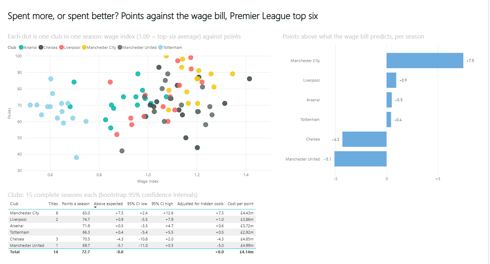

# Spent more, or spent better?: Power BI

Premier League top-six spending efficiency, 2008-09 to 2025-26, as a Power BI report: points against the wage bill, cost per point, and who really paid City's wages.

This folder is a Power BI project (`PL_Spending.pbip`): a TMDL semantic model and a PBIR report. It is generated from one Python spec, checked against Microsoft's JSON schemas, and its numbers are recomputed independently in pandas.



*In Power BI Desktop after a refresh. Every card matches `docs/expected_values.md`.*

## Open it

1. Open **`PL_Spending.pbip`** in Power BI Desktop. In versions before mid-2025, first turn on the preview features for Power BI Project (.pbip), the TMDL model format and the PBIR report format.
2. Click **Refresh**. The model reads this repo's cleaned CSVs from GitHub through the **BaseUrl** parameter. If asked, choose **Anonymous** access for `raw.githubusercontent.com`.
3. Check the visuals against [`docs/expected_values.md`](docs/expected_values.md).

## Pages

- **Who got value:** every club-season, wage index against points; points above what the wage bill predicts, per club; a club table with bootstrap confidence intervals and the verdict-adjusted figures.
- **Money:** squad cost by season; cost per point; City's wages to revenue 2009-10 to 2017-18 with and without owner-funded sponsorship; the same for every club.
- **Transfers:** every transfer in and out with fees in pounds; fees paid by season; club slicer.

## Model

- **Tables:** Efficiency, Clubs, Seasons, Transfers, Club Seasons.
- **Relationships:** Efficiency[club] to Clubs[club]; Transfers[club] to Clubs[club]; Efficiency[season] to Seasons[season]; Transfers[season] to Seasons[season]; Club Seasons[club] to Clubs[club]; Club Seasons[season] to Seasons[season].
- **22 DAX measures** in display folders: Results (Points, Titles, Average Points); Model (Expected Points, Points Above Expected, Points Above Expected per Season, Points Above Expected per Season (Adjusted), Average Wage Index); Money (Wage Bill, Revenue, Owner-Funded Sponsorship, Wages to Revenue, Wages to Revenue (Without Owner Money), Net Transfer Spend, Squad Cost, Cost per Point, Hidden Costs, City Wages to Revenue 2009-18, City Wages to Revenue 2009-18 (Without Owner Money)); Transfers (Transfer Fees Paid, Transfer Fees Received, Signings). The full DAX is in [`docs/measures.md`](docs/measures.md).

## Notes

- The regression (expected points from the wage index) and the bootstrap intervals are calculated in Python and loaded as columns; DAX aggregates them and builds the money measures.
- The model uses the 15 seasons where all six wage bills are known; the money measures use every season with accounts (`club_seasons.csv`), as the Python analysis does.
- `tools/expected.py` checks every club's titles, points, points above expected (both versions) and cost per point, and City's wage ratios, against the Python results: all agree.

## Rebuild and check

```bash
pip install jsonschema referencing pandas numpy
python tools/spec.py        # the spec: writes the .pbip and its folders
python tools/validate.py    # Microsoft schemas, field and DAX references, name clashes
python tools/expected.py    # what the report should show, checked against the project's own results
```

`tools/pbikit.py` is a small shared library for writing Power BI projects as code. It is used across the portfolio and encodes lessons from real Power BI Desktop runs: names are case-insensitive; a format string must not start with a quote; empty CSV cells must become null before a type change; in DAX, `BLANK() = FALSE()` is true.
